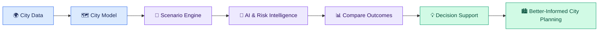
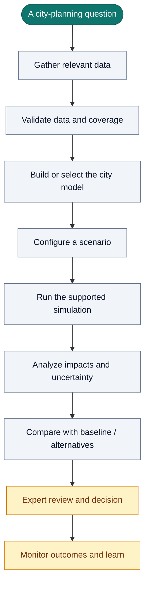
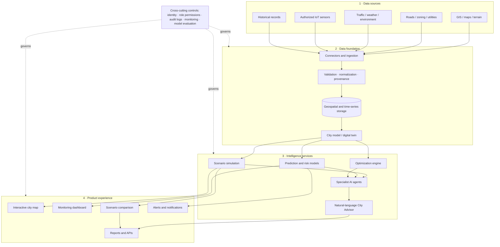
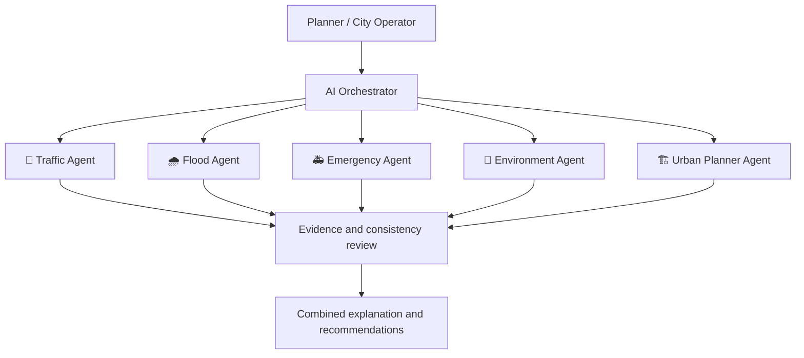
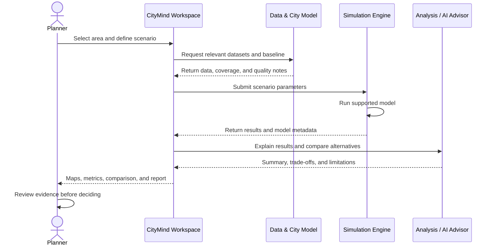
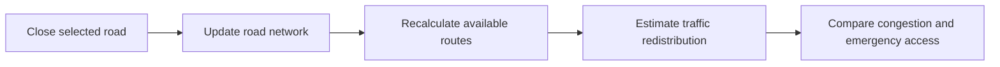
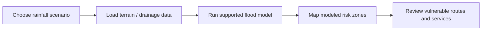
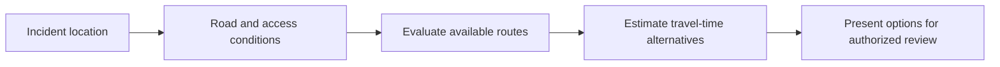
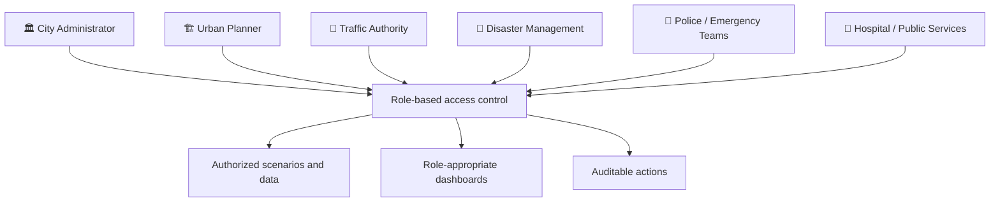
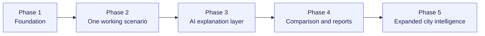

# 🏙️ CityMind

### AI Urban Simulation Engine · The Intelligence Layer for Smarter Cities

**Model urban challenges. Compare possible futures. Make better-informed decisions.**

  
  
  

> **CityMind is envisioned as an AI-powered urban decision-support platform** that brings city data, geospatial intelligence, scenario simulation, predictive models, and explainable recommendations into one workspace.

---

## 🧭 Contents

- [At a glance](#-at-a-glance)
- [The challenge](#-the-challenge)
- [The CityMind approach](#-the-citymind-approach)
- [How it works](#-how-it-works)
- [Platform architecture](#-platform-architecture)
- [Core intelligence modules](#-core-intelligence-modules)
- [Scenario workflow](#-scenario-workflow)
- [Example scenarios](#-example-scenarios)
- [Key dashboard indicators](#-key-dashboard-indicators)
- [Users and access](#-users-and-access)
- [Responsible AI and governance](#-responsible-ai-and-governance)
- [Proposed roadmap](#-proposed-roadmap)
- [Development setup](#-development-setup)
- [Project status](#-project-status)
- [Contributing](#-contributing)
- [License](#-license)

---

## ✨ At a glance

|                        |                                                                                                      |
| ---------------------- | ---------------------------------------------------------------------------------------------------- |
| **Product category**   | AI urban intelligence and simulation                                                                 |
| **Primary goal**       | Explore the potential impact of city decisions before implementation                                 |
| **Main inputs**        | GIS layers, city infrastructure data, traffic, weather, environmental data, and authorized IoT feeds |
| **Intelligence layer** | Scenario models, predictive analytics, optimization, and a natural-language City Advisor             |
| **Outputs**            | Maps, risk indicators, scenario comparisons, alerts, and decision-support reports                    |
| **Intended users**     | City administrators, urban planners, traffic authorities, and disaster-response teams                |

### The idea in one picture

---

## 🌆 The challenge

Cities operate as interconnected systems. A change to one road, drainage network, public transport route, or land-use plan can affect traffic, pollution, accessibility, public safety, and emergency response elsewhere.

Planning teams may have to work across fragmented datasets and separate tools. This can make it difficult to answer questions such as:

- What could happen if a major road closes during peak hours?
- Which areas may be vulnerable under a heavy-rainfall scenario?
- Where could a hospital or fire station improve service coverage?
- How might congestion influence pollution and emergency travel times?
- Which of two infrastructure proposals offers the better trade-off?

### Why a shared simulation workspace?

| Common planning difficulty             | CityMind's proposed response                                  |
| -------------------------------------- | ------------------------------------------------------------- |
| Data spread across different sources   | Bring supported data into a shared city view                  |
| Hard to compare possible interventions | Run and compare clearly defined scenarios                     |
| Risk is difficult to communicate       | Use geospatial layers, indicators, and visual reports         |
| Analysis requires specialist tools     | Add a natural-language advisor over supported data            |
| Assumptions can be overlooked          | Document inputs, model versions, uncertainty, and limitations |

---

## 💡 The CityMind approach

CityMind is intended to move planning from **“What is happening?”** toward **“What might happen if we act?”**

**Design principle:** simulations and predictions are decision-support evidence—not guaranteed outcomes or substitutes for accountable human judgment.

---

## 🏗️ Platform architecture

The following is a **conceptual architecture** for the proposed product. It is not a claim that every component has already been implemented.

### Architecture layers

| Layer                     | Responsibility                                                                                |
| ------------------------- | --------------------------------------------------------------------------------------------- |
| **Data sources**          | Supply authorized geospatial, infrastructure, environmental, operational, and historical data |
| **Data foundation**       | Validate, normalize, store, and track the origin and freshness of data                        |
| **City model**            | Represent relevant city assets, zones, networks, and state                                    |
| **Intelligence services** | Run supported simulations, predictions, risk analysis, and optimization                       |
| **AI advisor**            | Explain supported data and model results in natural language                                  |
| **Experience layer**      | Present maps, metrics, scenario comparisons, alerts, and reports                              |
| **Governance**            | Enforce permissions, audit important actions, and communicate limitations                     |

---

## 🧠 Core intelligence modules

The product vision is organized into connected modules. The list below describes the intended scope, not verified implementation status.

<strong>🏙️ 01 · City Digital Twin</strong>

A digital representation of selected city assets and conditions.

- 2D and 3D city visualization
- Zone-based segmentation and map layers
- Historical snapshots and scenario history
- Dynamic model updates
- Multi-city support as the platform matures

<strong>🧪 02 · AI Scenario Simulation</strong>

Explore potential outcomes from defined interventions or disruptive events.

- Road closures, lane closures, and signal changes
- Peak-hour and event traffic scenarios
- Rainfall increases and drainage blockage
- Pollution and emissions scenarios
- Crowd movement and evacuation planning
- Fire, flood, power-outage, and disaster scenarios
- Ambulance, fire-truck, and emergency routing

<strong>🔮 03 · Prediction and Risk Intelligence</strong>

Estimate future conditions where suitable data and validated models are available.

- Traffic and congestion forecasts
- Flood-risk and rainfall sensitivity analysis
- Pollution forecasts and hotspot detection
- Accident and infrastructure-risk indicators
- Public transport overload prediction
- Water and electricity demand estimates
- City resilience and disaster preparedness indicators

<strong>💬 04 · AI City Advisor</strong>

A natural-language interface for supported city datasets and analytical results.

Example questions:

- “Why is congestion increasing in this area?”
- “Compare these two road-management scenarios.”
- “Which locations have the highest modeled flood risk?”
- “Explain the assumptions behind this result.”

The advisor should distinguish observed facts, model outputs, and generated recommendations.

<strong>🗺️ 05 · GIS Intelligence</strong>

- Satellite, terrain, and road-network layers
- Weather, pollution, and flood overlays
- Population-density heatmaps
- Emergency routes and infrastructure layers
- Spatial clustering, route analysis, and risk scoring
- Boundary and zoning analysis

<strong>⚡ 06 · Optimization and Planning</strong>

- Traffic-flow and signal-timing optimization
- Emergency-route and public-transport planning
- Hospital and fire-station coverage
- Parking and EV charging placement
- Energy and water optimization
- Urban growth, density, and zoning scenarios
- Cost-benefit and infrastructure ROI analysis

<strong>📡 07 · Monitoring and IoT</strong>

Potential integrations include traffic cameras, smart signals, water-level sensors, air-quality sensors, weather stations, parking sensors, noise sensors, and utility telemetry.

Possible analytics include vehicle counting, crowd detection, flood detection, incident tracking, and configured risk alerts. Each integration depends on access rights, data quality, and technical feasibility.

<strong>👥 08 · Citizen Impact and Government Decision Intelligence</strong>

- Commute delay and accessibility analysis
- Healthcare and public-service access
- Citizen complaint clustering and sentiment analysis
- Policy scenario exploration
- Budget optimization and cost-benefit analysis
- Historical effectiveness analysis
- Decision-support reports

<strong>🤖 09 · Multi-Agent AI System</strong>

The long-term concept includes specialist agents with distinct responsibilities:

Agent outputs require validation and clear evidence boundaries; multiple agents do not automatically make a result correct.

---

## 🔄 Scenario workflow

A scenario is a structured question with a baseline, a proposed change, and measurable outcomes.

### Scenario comparison example

**Question:** Should the city build a flyover or retain the current road layout?

| Comparison dimension  | Scenario A: Build flyover              | Scenario B: Keep current layout      |
| --------------------- | -------------------------------------- | ------------------------------------ |
| Congestion            | Evaluate modeled change                | Establish baseline                   |
| Pollution             | Estimate if supported by model         | Establish baseline                   |
| Emergency delay       | Evaluate route and travel-time effects | Establish baseline                   |
| Economic cost         | Estimate project and maintenance cost  | Estimate ongoing / alternative costs |
| Citizen inconvenience | Assess construction and access impacts | Assess continued congestion impacts  |

No result should be pre-filled as a fact. Each metric must be calculated from documented assumptions, suitable data, and an appropriate method.

---

## 🌧️ Example scenarios

### 1. Road closure

**Potential output:** affected routes, modeled congestion changes, emergency-access concerns, and alternative interventions.

### 2. Heavy rainfall

**Potential output:** modeled flood-risk areas and candidate locations for further assessment. Reliable results require appropriate terrain, rainfall, and drainage data.

### 3. Emergency response

**Potential output:** route alternatives and modeled response-time comparisons. Any operational emergency use requires robust validation and human oversight.

---

## 📊 Key dashboard indicators

The proposed monitoring dashboard may combine live indicators and model-derived estimates.

| Indicator               | What it communicates                          | Potential source                              |
| ----------------------- | --------------------------------------------- | --------------------------------------------- |
| Congestion index        | Traffic pressure by area or road              | Traffic feeds and road-network models         |
| Pollution score         | Environmental conditions or modeled emissions | Air-quality sensors and validated models      |
| Flood-risk score        | Relative risk under a defined scenario        | Rainfall, terrain, drainage, and flood models |
| Emergency response time | Observed or estimated travel time             | Incident and routing data                     |
| Road utilization        | Relative use of road capacity                 | Traffic counts and network data               |
| Public-transport load   | Demand or crowding                            | Transit feeds and passenger counts            |
| Water / power usage     | Utility demand and trends                     | Authorized utility telemetry                  |
| Infrastructure health   | Condition or risk indicators                  | Inspection records and sensor data            |

> **Visual design recommendation:** show the current value, trend, geographic scope, last-updated time, source, and whether a value is measured or modeled. Avoid presenting estimates as live measurements.

---

## 👥 Users and access

Permissions should be explicit and based on each role's responsibilities. Access to scenario editing, sensitive data, city-model changes, and emergency workflows must not be assumed to be universal.

---

## 🛡️ Responsible AI and governance

City-scale analysis can influence public resources, mobility, safety, and access to services. Trustworthiness must be part of the design.

- **Data provenance:** record where datasets came from and when they were updated.
- **Transparency:** expose model assumptions, coverage, and limitations.
- **Uncertainty:** distinguish predictions from verified observations.
- **Human oversight:** require qualified review for high-impact decisions.
- **Access control:** use authentication and least-privilege permissions.
- **Auditability:** log important scenario changes and administrative actions.
- **Privacy:** minimize personal data and respect retention requirements.
- **Security:** protect credentials, restricted infrastructure data, and external integrations.
- **Validation:** evaluate models against suitable reference data and known failure cases.

CityMind should not be the sole basis for emergency response or other high-impact decisions without domain validation, operational safeguards, and authorized human oversight.

---

## 🗺️ Proposed roadmap

The roadmap below prioritizes a small, testable workflow before expanding toward the full vision.

| Phase                          | Focus                                                              | Suggested deliverable                         |
| ------------------------------ | ------------------------------------------------------------------ | --------------------------------------------- |
| **1 · Foundation**             | Define a target city, use case, data sources, and core application | Initial city view and validated data pipeline |
| **2 · First scenario**         | Implement one focused scenario, such as road closure               | Baseline-versus-scenario results              |
| **3 · AI explanations**        | Explain supported results with clear evidence boundaries           | Natural-language scenario summary             |
| **4 · Comparison and reports** | Compare alternatives and retain scenario history                   | Exportable, reproducible analysis             |
| **5 · Expanded intelligence**  | Add additional models, feeds, roles, and alerts                    | Broader city-planning workspace               |

### Suggested first milestone

A strong initial demonstration could let a user select a road segment, simulate a closure using a clearly documented model, view the modeled network impact, compare it with a baseline, and generate a concise explanation of assumptions and limitations.

---

## 🚀 Development setup

The source concept does not specify a confirmed implementation stack, package manager, environment-variable names, database schema, or runnable application commands. Those details should be filled in from the actual repository rather than guessed.

Before publishing setup instructions, document:

1. Required runtime and supported versions
2. Installation and dependency commands
3. Environment variables and how to configure them
4. Data-source and API credentials
5. Database setup and migrations, if applicable
6. Development, test, lint, and build commands
7. Deployment process and required services

### Environment and secrets

- Do not commit `.env` files, API keys, passwords, or private datasets.
- Provide a `.env.example` with variable names and safe placeholder values.
- Document the permissions required for each external data source.
- Keep credentials on the server side when they do not need to be exposed to the browser.

---

## 📌 Project status

**Current documentation stage:** concept, architecture proposal, and roadmap.

The diagrams and modules in this README explain the intended product direction. They do not imply that the corresponding code, integrations, models, or production safeguards are already implemented. Update this section as verified capabilities are built and tested.

A practical status convention for future updates:

- `Planned` — scoped but not implemented
- `In progress` — implementation underway
- `Prototype` — demonstrable but not fully validated
- `Validated` — tested against defined acceptance criteria
- `Production-ready` — operational, secured, monitored, and reviewed

---

## 🤝 Contributing

Contributions are welcome when they improve reliability, usability, explainability, or validated city analysis.

1. Open an issue describing the problem or proposed improvement.
2. Agree on scope, data requirements, and acceptance criteria.
3. Create a focused branch and implement the change.
4. Add tests or validation evidence.
5. Document new assumptions, sources, and limitations.
6. Submit a pull request for review.

For simulation and prediction changes, include the model/data source, evaluation method, known failure cases, and reproducible test scenarios.

---

## 📄 License

No project license has been specified in the supplied concept. Add an appropriate `LICENSE` file before distributing the project or accepting contributions. Verify the licenses and terms for all third-party software, map tiles, models, and datasets.

---

### 🌐 Explore the consequences before making the decision.

**CityMind — Toward a more informed, resilient, and connected urban future.**

