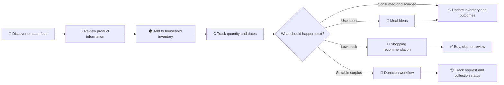
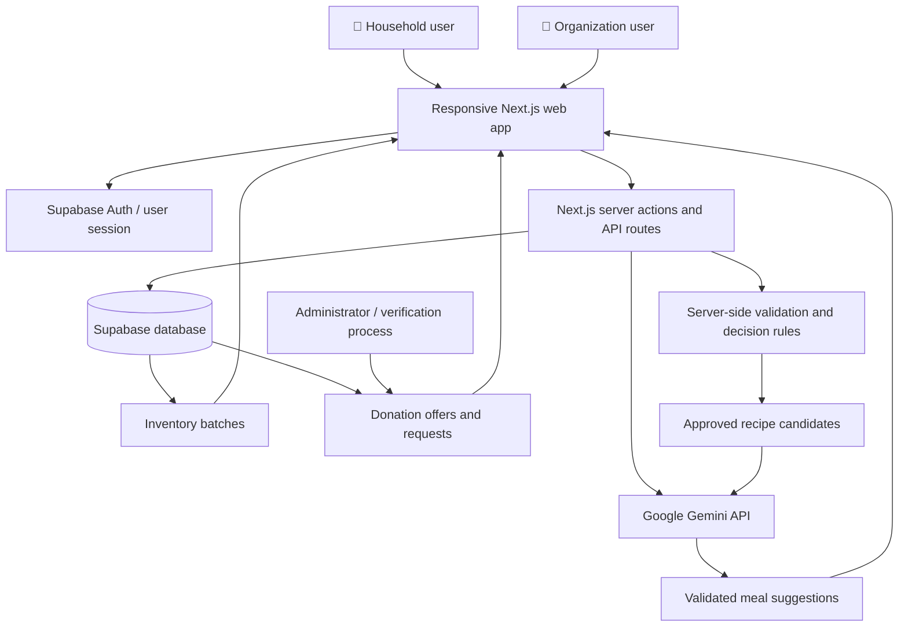
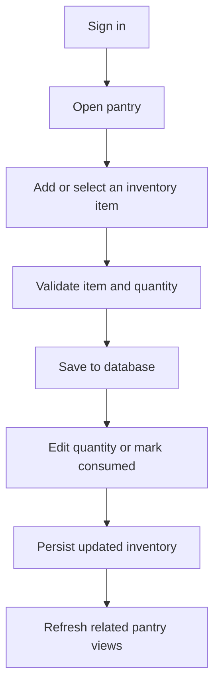
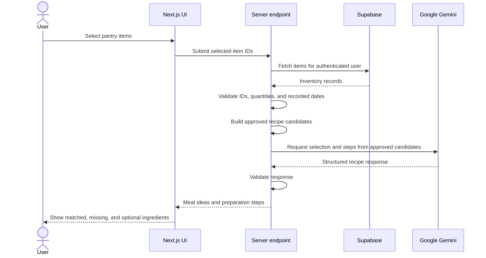
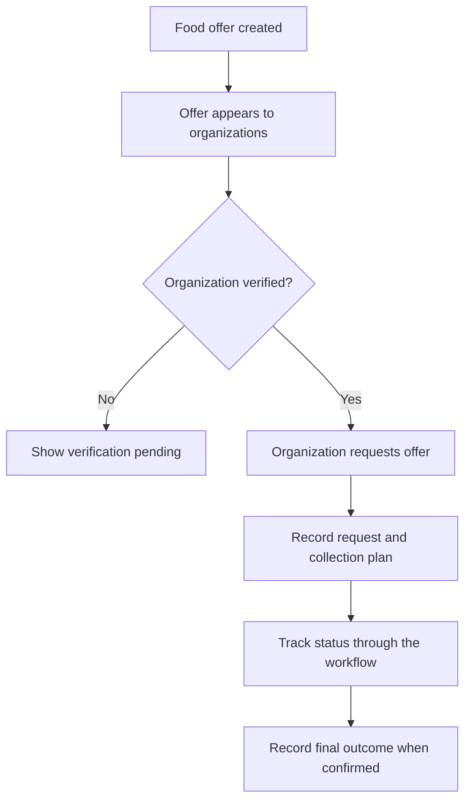
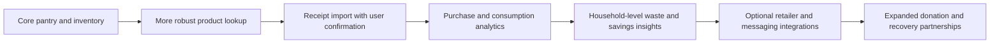

<div align="center">

# 🥬 SmartPantry AI

### Intelligent Grocery Decisions & Food Waste Management

**Know what you have. Use food on time. Shop with purpose. Waste less.**

A household grocery intelligence platform that connects pantry inventory, expiry awareness, AI-assisted meal ideas, smarter shopping decisions, and surplus-food recovery in one workflow.


</div>

---

## 📌 Table of Contents

- [Overview](#-overview)
- [The Problem](#-the-problem)
- [Our Solution](#-our-solution)
- [How It Works](#-how-it-works)
- [Key Features](#-key-features)
- [Application Architecture](#-application-architecture)
- [Core Workflows](#-core-workflows)
- [Technology Stack](#-technology-stack)
- [Getting Started](#-getting-started)
- [Environment Variables](#-environment-variables)
- [Data and Safety Principles](#-data-and-safety-principles)
- [Roadmap](#-roadmap)
- [Contributing](#-contributing)

---

## 🌱 Overview

SmartPantry AI helps households make better grocery decisions throughout the food lifecycle—from understanding packaged food before purchase to tracking it at home and deciding what to use, buy, or share.

Instead of treating food scanning, pantry tracking, meal planning, and food donation as disconnected tools, SmartPantry AI connects them into a single decision loop.

> **Product principle:** Capture reliable information → keep inventory current → recommend an explainable next action → record the outcome → learn from the results.

### The connected grocery lifecycle



---

## 🚨 The Problem

Households often manage groceries using memory, packaging, receipts, and separate applications. This can lead to:

- **Forgotten food:** products remain unused until their recorded date passes or quality deteriorates.
- **Duplicate purchases:** people buy items they already have.
- **Unexpected stockouts:** essential ingredients run out because quantities are not tracked.
- **Confusing product labels:** nutrition facts and ingredient lists can be difficult to compare quickly.
- **Unmeasured waste:** consumed and discarded quantities are rarely recorded consistently.
- **Missed recovery opportunities:** suitable surplus may be discarded instead of offered to an organization that can accept it safely and in time.

SmartPantry AI addresses both sides of grocery management: **better decisions before buying and better decisions after food enters the home.**

---

## 💡 Our Solution

SmartPantry AI brings together five connected capabilities:

| Capability                   | What it helps users do                                                                              |
| ---------------------------- | --------------------------------------------------------------------------------------------------- |
| **Product awareness**        | Look up available packaged-food information and review what is known or missing.                    |
| **Pantry inventory**         | Record products, quantities, units, and relevant dates in one place.                                |
| **Use-first and meal ideas** | Identify suitable items to use and generate meal suggestions from selected pantry ingredients.      |
| **Smarter shopping**         | Compare a proposed purchase with current inventory and make a more informed decision.               |
| **Surplus-food recovery**    | Offer suitable surplus and let verified organizations request donations through a tracked workflow. |

The central differentiator is the **connected decision loop**, not simply a barcode scanner or chatbot.

---

## ✨ Key Features

### 🏠 1. Household Inventory

- Keep pantry items and inventory batches in one place.
- Track product names, quantities, units, and recorded dates.
- Edit remaining quantities as stock changes.
- Mark items as consumed when they are finished.
- Keep inventory changes tied to the authenticated user.
- Use inventory information to support other decisions in the application.

### ⏰ 2. Expiry-Aware Decisions

- Identify items approaching their recorded expiry date.
- Prioritize suitable items when generating meal ideas.
- Avoid treating a recorded date as a guarantee of food safety.
- Keep unknown or missing date information distinct from known dates.

### 🍲 3. AI-Assisted Meal Ideas

- Select items from the current pantry inventory.
- Find candidates from an approved recipe set.
- Use Google Gemini to select from the supplied candidates and return preparation steps.
- Show matched pantry ingredients, required ingredients that are missing, optional ingredients, and preparation steps.
- Apply validation to selected inventory items before generating suggestions.

**Design choice:** AI helps explain and prepare an approved candidate recipe list; it should not invent pantry stock or silently claim that an unverified recipe matches the selected items.

### 🛒 4. Smarter Shopping Decisions

The intended workflow compares proposed purchases with existing inventory to help users decide whether to buy, skip, or review an item. Recommendation rules should be transparent and based on the current pantry state rather than unsupported model guesses.

### 🤝 5. Surplus-Food Donation Workflow

- Make surplus-food offers available for organizations to browse.
- Allow organizations to request suitable offers when verified.
- Show offer and request status so the workflow can be tracked.
- Keep organization verification as a prerequisite for requesting donations.
- Distinguish an offer or request from a confirmed collection or successfully rescued food.

### 📊 6. Waste and Household Insights

The product vision includes recording consumption and discard events to improve inventory accuracy and support household-level waste and purchasing insights. Any impact estimates should clearly distinguish recorded outcomes from simulated results.

---

## 🏗️ Application Architecture

The architecture below reflects the observed application patterns and intended product flow. Optional integrations and future modules are not assumed to be implemented.



### Architecture responsibilities

| Layer                           | Responsibility                                                                                |
| ------------------------------- | --------------------------------------------------------------------------------------------- |
| **Next.js UI**                  | Presents pantry inventory, meal ideas, and donation workflows.                                |
| **Authentication**              | Identifies the signed-in user and supports user-scoped operations.                            |
| **Server actions / API routes** | Validate requests, apply business rules, and coordinate data and AI calls.                    |
| **Supabase**                    | Stores application data and supports authentication/database access.                          |
| **Google Gemini**               | Assists with meal selection and preparation steps using approved candidate data.              |
| **Decision rules**              | Handle deterministic checks such as selected-item validation and inventory-based eligibility. |

---

## 🔄 Core Workflows

### Workflow A — Manage pantry stock



### Workflow B — Generate meal ideas



### Workflow C — Request surplus food



---

## 🧰 Technology Stack

| Technology               | Purpose                                                   |
| ------------------------ | --------------------------------------------------------- |
| **Next.js (App Router)** | Web application and server-side workflows                 |
| **React**                | Interactive user interface                                |
| **Tailwind CSS**         | Styling and responsive layouts                            |
| **Supabase**             | Authentication and PostgreSQL-backed application data     |
| **Google Gemini API**    | AI-assisted meal selection and preparation guidance       |
| **JavaScript / JSX**     | Application implementation in the available code examples |

The exact versions, full dependency list, and deployment provider should be taken from the repository's `package.json` and deployment configuration.

---

## 🚀 Getting Started

> The commands below are a standard starting point for a Next.js application. Check your repository scripts and installed package manager before running them.

### Prerequisites

- Node.js LTS
- npm, pnpm, or the package manager used by the repository
- A Supabase project with the required database tables and authentication configured
- A Google Gemini API key for AI-assisted meal suggestions

### 1. Clone the repository

```bash
git clone <YOUR_REPOSITORY_URL>
cd <YOUR_PROJECT_DIRECTORY>
```

### 2. Install dependencies

For npm projects:

```bash
npm install
```

### 3. Configure environment variables

Create a `.env.local` file in the project root and add the variables required by your Supabase client and Gemini integration. Use the variable names already referenced by your source code.

Example:

```env
# Use the exact names expected by your Supabase client setup.
NEXT_PUBLIC_SUPABASE_URL=your_supabase_project_url
NEXT_PUBLIC_SUPABASE_ANON_KEY=your_supabase_anon_key

# Server-side AI integration
GEMINI_API_KEY=your_gemini_api_key
GEMINI_MODEL=gemini-2.5-flash
```

**Important:** If your repository uses different Supabase environment variable names, keep the names from your existing code. Never commit `.env.local`, service-role keys, or API secrets.

### 4. Prepare the database

Configure the required Supabase tables, relationships, and Row Level Security policies before testing the application. The code excerpts refer to pantry inventory batches and donation offers/requests; verify the actual schema and policies in your project before deployment.

### 5. Run the development server

```bash
npm run dev
```

Open `http://localhost:3000` in your browser.

### 6. Verify the production build

```bash
npm run build
npm run start
```

Run these commands after checking that the scripts exist in your `package.json`.

---

## 🔐 Data and Safety Principles

SmartPantry AI is designed around transparent, user-confirmed decisions.

- **Do not fabricate missing product data.** Display unknown or unavailable fields clearly.
- **Explain recommendations.** Users should be able to understand why an item is suggested, skipped, or flagged for review.
- **Validate on the server.** Do not trust client-supplied user IDs, inventory quantities, or selected item IDs.
- **Respect user data boundaries.** Database queries and Row Level Security should prevent users from accessing other users' inventory.
- **Treat food dates carefully.** An expiry date entered in an app is not a guarantee of safety; users should inspect labels and follow applicable food-safety guidance.
- **Avoid medical claims.** Product information is for awareness and decision support, not diagnosis or treatment.
- **Keep donation statuses honest.** An offer, request, collection, and completed recovery are different events.
- **Label simulations.** Estimated savings or waste reductions must not be presented as measured real-world outcomes unless supported by actual data.

---

## 🗺️ Roadmap

This roadmap describes potential next steps; it is not a claim that every item is already implemented.



| Area            | Possible next step                                                                                  |
| --------------- | --------------------------------------------------------------------------------------------------- |
| Product data    | Improve barcode lookup, source visibility, and missing-field handling.                              |
| Inventory       | Add receipt-assisted entry with confirmation before saving changes.                                 |
| Recommendations | Expand explainable use-first, replenish, buy, skip, and review rules.                               |
| Analytics       | Compare baseline and assisted scenarios using documented assumptions.                               |
| Donation        | Track offer, acceptance, collection, receipt, and final outcome separately.                         |
| Integrations    | Explore retailer, messaging, and external partner integrations after the core workflow is reliable. |

---

## 🤝 Contributing

Contributions and suggestions are welcome.

1. Fork the repository.
2. Create a focused branch: `git checkout -b feature/your-feature`.
3. Make and test your changes.
4. Commit with a clear message.
5. Open a pull request describing the change and any required configuration or database updates.

For changes involving inventory, authentication, or donations, include tests or a reproducible verification procedure where possible.

---

## 📄 License

No license was specified in the provided project materials. Add a `LICENSE` file and update this section before distributing the project publicly.

---

<div align="center">

### 🥦 Better grocery decisions. Less avoidable food waste.

**SmartPantry AI — from pantry awareness to meaningful action.**

</div>
